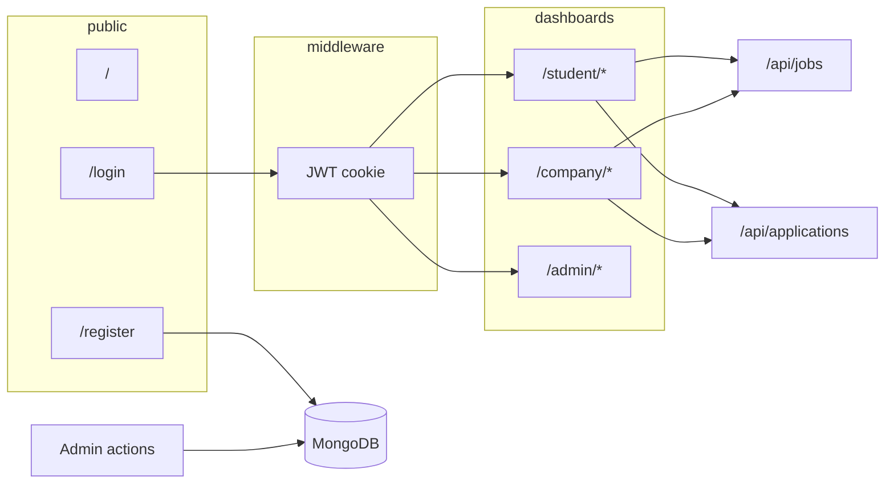

# Campus Recruitment — Project overview

This document describes **aziz-project**: architecture, data model, authentication, API behavior, and role-based flows.

---

## What this project is

**Campus Recruitment** is a **Next.js** web application that connects three roles:

| Role      | Purpose |
|-----------|---------|
| **Student** | Browse jobs from active companies, apply, track applications, and maintain a profile (including resume and links). |
| **Company** | Post and manage jobs, review applicants, and maintain a company profile. |
| **Admin**   | Block or unblock users, bulk-block accounts, and oversee platform usage via dashboards and listings. |

The **home page** (`src/app/page.tsx`) is a marketing-style landing with links to **Sign in** and **Register**. The product experience lives under role paths: `/student/...`, `/company/...`, `/admin/...`.

---

## Tech stack

| Layer | Technology |
|-------|------------|
| Framework | Next.js **16** (App Router), React **19**, TypeScript |
| Database | **MongoDB** via **Mongoose** (`src/lib/mongoose.ts`) |
| Auth | **bcryptjs** for passwords; **jose** for signed JWTs in an **httpOnly** cookie (`campus_session`, 7 days — `src/lib/constants.ts`) |
| Validation | **Zod** (`src/lib/validators.ts`), often with **react-hook-form** on the client |
| Client state | **Zustand** (`src/stores/auth-store.ts`) for the logged-in user after hydration |
| Data fetching | **SWR** on some dashboard pages (e.g. student job list via `swrFetcher`) |
| UI | **Tailwind CSS 4**, **Radix UI**, shadcn-style components (`src/components/ui/`), **next-themes**, **Sonner** |
| Uploads | **Cloudinary** (`src/lib/cloudinary-upload.ts`, `src/app/api/upload/route.ts`) — images and PDFs up to 5MB |

---

## Data model (MongoDB)

### User (`src/models/User.ts`)

- `email`, `password`, `name`, `role` (`student` | `company` | `admin`).
- `status`: `active` | `blocked` (new signups are `active` immediately).
- **Embedded `studentProfile`**: university, degree, major, graduation year, GPA, skills, bio, `profilePicture`, `resumeUrl`, LinkedIn, GitHub, phone, location, etc.
- **Embedded `companyProfile`**: company name, industry, website, description, location, logo, founded year, employee count, contact email, phone, etc.

### Job (`src/models/Job.ts`)

- References **company** (`User`).
- Title, description, requirements and responsibilities arrays, `type`, location, remote flag, salary range, skills, deadline.
- `status`: `open` | `closed` | `draft`.
- Experience level, positions count.
- Text index on title/location for search-related behavior.

### Application (`src/models/Application.ts`)

- References **job**, **student** (`User`), and **company** (`User`).
- `status`: pending, reviewed, shortlisted, rejected, accepted; cover letter; notes; `appliedAt`.
- **Unique** compound index on `(job, student)` so one application per student per job.

---

## Authentication and session flow

1. **Register** (`POST /api/auth/register`): Creates a user with `status: "active"`. **No session cookie** is set — the user signs in afterwards on the login page.

2. **Login** (`POST /api/auth/login`):
   - Validates credentials.
   - Returns `403` with code `BLOCKED` for blocked users.
   - On success: signs a JWT (`signSessionToken`) and sets the **httpOnly** session cookie.
   - Returns a **serialized user** (password stripped) for the client.

3. **JWT payload** (`src/lib/jwt.ts`): `sub` (user id), `role`, `status`, `email`, `name`.

4. **Current user** (`GET /api/auth/me`): Resolves the user from the cookie via `getCurrentUser()` (verify JWT → load `User` from MongoDB without password).

5. **Logout** (`POST /api/auth/logout`): Deletes the session cookie.

6. **Client bootstrap**: `AuthHydration` in `src/components/providers.tsx` calls `hydrateUser()` on mount, which fetches `/api/auth/me` and populates the Zustand store.

---

## Middleware and route protection

File: `src/middleware.ts`.

**Matched paths:** `/admin/:path*`, `/company/:path*`, `/student/:path*`.

**Behavior:**

1. No `campus_session` cookie → redirect to **`/login`** with `?from=<original path>`.
2. Invalid or expired token → redirect to **`/login`** and clear the cookie.
3. Path `/admin/*` requires JWT `role === "admin"` (and similarly `/company/*` → `company`, `/student/*` → `student`); otherwise redirect to **`/unauthorized`**.

**Note:** `/`, `/login`, and `/register` are **not** protected by this middleware (public).

---

## API surface

| Area | Routes | Behavior |
|------|--------|----------|
| Auth | `POST /api/auth/login`, `register`, `logout`; `GET /api/auth/me` | Register, login (sets cookie), logout, session user |
| Profile | `GET`, `PUT /api/profile` | Logged-in user reads/updates name and role-specific profile |
| Upload | `POST /api/upload` | Multipart file → Cloudinary URL under `campus/{userId}/` |
| Jobs | `GET`, `POST /api/jobs` | Role-scoped listing with filters; companies create jobs |
| Job by id | `GET`, `PUT`, `DELETE /api/jobs/[id]` | Company owner or admin; student can GET only open jobs from active companies |
| Applications | `GET`, `POST /api/applications` | Student: own list; company: company’s apps (optional `?jobId=`); admin: overview |
| Application by id | `GET /api/applications/[id]`, `PUT` | Scoped read; company updates status/notes via `PUT` |
| Admin users | `GET /api/admin/users`, `GET`/`PUT /api/admin/users/[id]`, `PATCH /api/admin/users/bulk` | List/filter, single block/unblock, bulk block |
| Users alias | `GET /api/users` | Re-exports the admin users list |

### Job listing rules (high level)

- **Students** see only jobs with `status: "open"` from companies that are `active`.
- **Companies** see only **their** jobs (optional status filter).
- **Admins** see jobs according to admin filters in `GET /api/jobs`.

---

## Flows by role

### Student

1. Register → account is active immediately.
2. Login works right away; middleware allows `/student/*` only for `role === "student"`.
3. **Navigation** (`src/components/dashboard/student-shell.tsx`): Dashboard → Browse jobs → Applications → Profile.
4. **Jobs:** List/detail use the jobs API; applying uses `POST /api/applications`.
5. **Applications:** Listed via `GET /api/applications` for the current student.
6. **Profile:** Updated via `PUT /api/profile`; assets via `POST /api/upload`.

### Company

1. Register as company → active immediately, same as students.
2. **Navigation** (`company-shell.tsx`): Dashboard, Jobs, Post job, Profile.
3. **Jobs:** `POST /api/jobs` to create; `PUT`/`DELETE /api/jobs/[id]` to edit/remove own jobs.
4. **Applicants:** Typically filtered via `GET /api/applications?jobId=...`; pipeline updates with `PUT /api/applications/[id]`.

### Admin

1. **Bootstrap:** `npm run seed:admin` (`scripts/seed-admin.ts`) creates an admin user with `status: "active"` (requires `MONGODB_URI`; optional `SEED_ADMIN_EMAIL`, `SEED_ADMIN_PASSWORD`, `SEED_ADMIN_NAME`).
2. **Navigation** (`admin-shell.tsx`): Admin dashboard, Users.
3. **User management:** Block or unblock users (single), or bulk-block.
4. **Jobs/applications:** Broader API access than student/company for oversight (see route handlers).

---

## Frontend architecture

- **Route groups:** `(auth)` for login/register layout; `(dashboard)` wraps student, company, and admin with per-role layouts and **Shell** components.
- **`DashboardShell`:** Shared layout — sidebar, theme toggle, user menu, logout using `useAuthStore`.
- **Root layout** (`src/app/layout.tsx`): Fonts, `Providers` (theme, auth hydration, toaster).

---

## Environment and operations

| Variable | Purpose |
|----------|---------|
| `MONGODB_URI` | MongoDB connection string |
| `JWT_SECRET` | At least 16 characters; signs session JWTs |
| Cloudinary | Required for `/api/upload` (see `src/lib/cloudinary.ts`) |

---

## Conceptual architecture diagram

---

## Key file map

| Area | Path |
|------|------|
| Middleware | `src/middleware.ts` |
| Session / user helpers | `src/lib/auth.ts`, `src/lib/jwt.ts` |
| Models | `src/models/User.ts`, `Job.ts`, `Application.ts` |
| Auth API | `src/app/api/auth/*` |
| Stores | `src/stores/auth-store.ts` |
| Dashboard shells | `src/components/dashboard/*-shell.tsx` |

---

*Generated to document the Campus Recruitment codebase structure and flows.*
